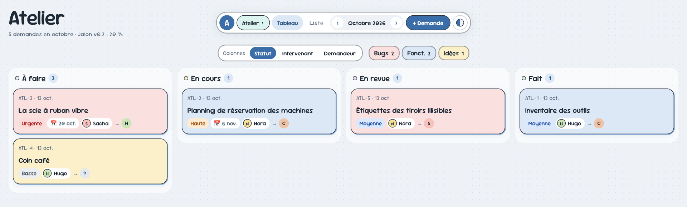

# Ardoise

Un tableau de suivi — bugs, fonctionnalités, idées — dont chaque carte est une
note de ton vault Obsidian. Appli de bureau, Linux et Windows, sans serveur.



- Tableau par statut, intervenant ou demandeur, glisser-déposer
- Plusieurs projets, priorités, échéances, descriptions
- Modifiable dans l'app **et** dans Obsidian : les deux restent synchronisés
- Quatre thèmes de couleurs

## Essayer

Il faut [Flutter](https://docs.flutter.dev/get-started/install) et, sous
Linux, `clang cmake ninja-build pkg-config libgtk-3-dev`.

```bash
git clone https://github.com/Golden76z/ardoise && cd ardoise
cp -r exemple/vault-demo ~/ardoise-demo
ARDOISE_VAULT=~/ardoise-demo flutter run -d linux   # ou -d windows
```

Sans `ARDOISE_VAULT`, l'app demande le dossier de ton vault au premier
lancement. Elle n'écrit que dans son dossier `Ardoise/`.

## Licence

MIT
